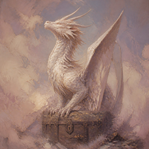
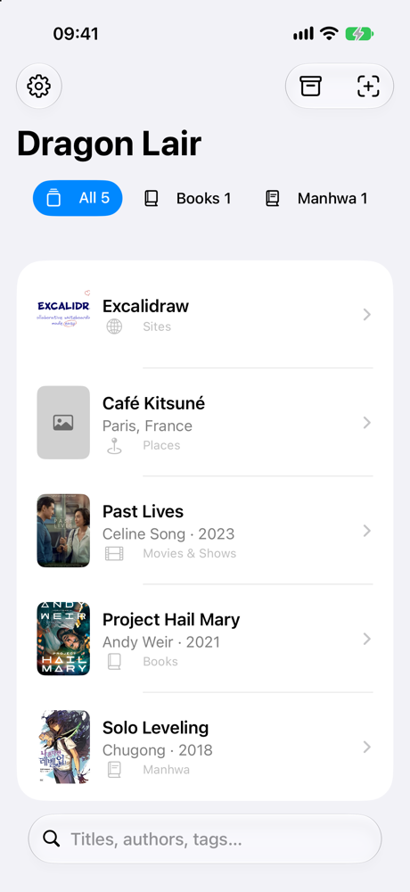
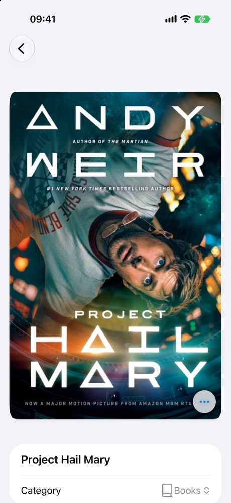
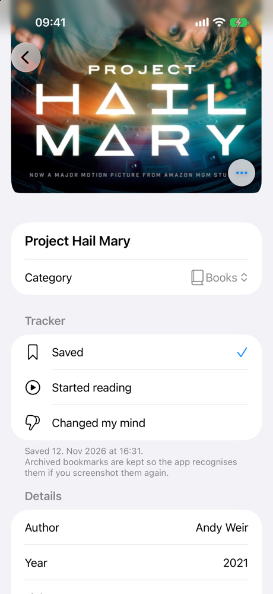
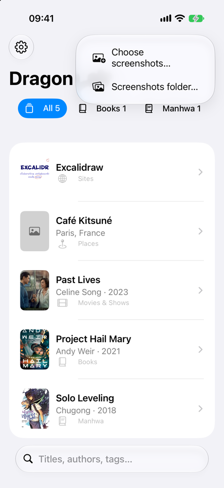

<p align="center">
  
</p>

<h1 align="center">Dragon Lair</h1>

<p align="center">
  Screenshot something you want to read, watch, visit or buy — Dragon Lair turns it into a bookmark.
</p>

<p align="center">
  
  
  
</p>

<p align="center">
  
  
  
  
</p>

## What it does

Dragon Lair (project name *EndlessBookmark*) is a personal hoard of things you came across and want to get back to. Instead of typing them in, you feed it screenshots: an AI model reads each one and saves what it shows as a bookmark with a title, author, year, summary and tags.

- **Seven categories** — books, manhwa, movies & shows, sites, places, products and other.
- **Screenshot import** — pick screenshots, share them from any app through the Share Extension, or connect the Screenshots album so new ones are offered for import. Imports keep running in the background.
- **Your choice of AI** — Claude, OpenAI or Gemini, with your own API key.
- **Official covers** — looked up automatically from Open Library, Google Books, Hardcover, TMDB, TVmaze, AniList, iTunes, Wikipedia and Open Food Facts. The keyless sources work out of the box; free personal keys find more.
- **Tracker** — mark a bookmark *started* (swipe right) or *changed my mind* (swipe left). Archived bookmarks are kept, so screenshotting the same thing again is recognised instead of duplicated.
- **Quick actions** — long-press a row and slide onto an icon to act on it.
- **Photos clean-up** — once a screenshot is saved, delete the original from Photos in one go. Each bookmark keeps its own copy.
- **Backups** — a JSON file plus screenshot copies in any Files folder, such as iCloud Drive. Restoring twice never creates duplicates.

## Privacy

There is no server. Bookmarks stay on the device, API keys are stored in the Keychain, and a screenshot is sent to your chosen AI provider only when you import it.

## Building

Requirements: Xcode with the iOS 18 SDK or later.

1. Open `EndlessBookmark.xcodeproj`.
2. Under *Signing & Capabilities*, choose your own team for both the **EndlessBookmark** and **ShareExtension** targets. Change the bundle identifiers and App Group (`group.com.lirriel.endlessbookmark`) if they're taken.
3. Run on a device or simulator.
4. In the app, open **Settings** and add an API key for one AI provider.

The Xcode project is generated from [`project.yml`](project.yml) with [XcodeGen](https://github.com/yonaskolb/XcodeGen). After changing targets or settings there, regenerate it:

```bash
xcodegen generate
```

In Debug builds, launch with the `-seedSamples` argument to fill an empty library with a few sample bookmarks.

## Project layout

| Path | Contents |
| --- | --- |
| `EndlessBookmark/Models` | SwiftData models: bookmarks and scanned screenshots |
| `EndlessBookmark/Services` | AI client, import queue, background import, cover lookup, backups, settings |
| `EndlessBookmark/Views` | SwiftUI screens |
| `ShareExtension` | Share sheet target that hands screenshots to the app |
| `Shared` | Code used by both targets (the shared inbox in the App Group) |
| `Design` | The app icon and its source; earlier concepts are in `Design/explorations` |
